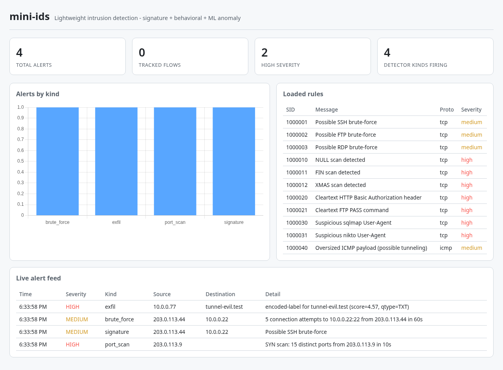

# mini-ids

A lightweight network intrusion detection system in Python + Scapy. It combines a Snort-lite signature rule engine, three behavioral detectors (port scan, brute force, DNS exfiltration/tunneling), and an optional unsupervised ML anomaly detector, all feeding one alert pipeline with console/log/webhook/email sinks and a live web dashboard.

> **Scope and ethics.** This project is for **educational, defensive and offensive** security learning. Run the sniffer only against your own machines or networks, and run the offensive demo traffic in `offensive/` **only against lab targets you own or are explicitly authorized to test** - it refuses any target that isn't loopback, RFC1918-private, or link-local unless you pass `--i-understand-lab`. You are responsible for complying with the laws and policies that apply to you.

## Screenshot



## Features

- **Snort-lite rule engine** (`rules/`): parses a real Snort rule syntax subset (`action proto src_ip src_port -> dst_ip dst_port (msg:"..."; flags:S; content:"..."; nocase; threshold: type threshold, track by_src, count 5, seconds 60; sid:1000001; severity:medium;)`), including per-rule `threshold` counters and `dsize` payload-size matching. Ships 11 builtin rules covering brute-force thresholds, NULL/FIN/XMAS scan signatures, cleartext credentials, suspicious scanner User-Agents, and oversized ICMP payloads.
- **Behavioral detectors** (`detectors/`): distinct-port-per-source port-scan detection with scan-type classification (SYN/NULL/FIN/XMAS/ACK), sliding-window brute-force counting on sensitive ports, and DNS-tunneling/exfiltration detection (entropy, subdomain fan-out, payload-flood).
- **Optional ML anomaly detector**: an `IsolationForest` (scikit-learn) over per-flow features (duration, packet/byte counts, average packet size, SYN count, flag diversity), trained on a synthetic benign baseline, gated behind `--enable-ml`.
- **Alert pipeline** (`alerts/`): a cooldown/anti-spam dispatcher fanning out to console, JSONL log, webhook (HTTP POST), and SMTP email sinks - every sink is fail-soft, so a broken mail server or unreachable webhook never takes the engine down.
- **Live dashboard** (`dashboard/`): Flask + Socket.IO, stat tiles, an alerts-by-kind chart, the loaded ruleset, and a live alert feed.
- **Lab-only offensive traffic generators** (`offensive/`): a Scapy SYN port-scanner and a repeated-connection-attempt simulator to prove the detectors actually catch something, guarded by a loopback/RFC1918-only lab check.

## Architecture

```
mini-ids/
├── mini_ids.py / cli.py     # engine assembly + argparse CLI (sniff/replay/rules/stats/attack)
├── core/                    # config dataclasses + PacketRecord/Flow/Alert data contracts
├── engine/                  # capture (live + pcap), dissect, flow tracking, IDSEngine pipeline
├── rules/                   # Snort-lite parser/matcher + builtin/default.rules
├── detectors/               # port_scan, brute_force, exfil, ml_anomaly
├── alerts/                  # dispatcher + console/log/email/webhook sinks
├── storage/                 # thread-safe SQLite store for alerts + flows
├── dashboard/               # Flask + Socket.IO live dashboard
├── offensive/               # lab-only traffic generators (+ guard.py safety check)
├── evals/                   # seeded synthetic corpora + precision/recall gate
├── samples/                 # offline no-root demo
└── tests/                   # pytest gate suite (no root, no live network)
```

Data flow: a raw Scapy packet enters `IDSEngine.process()` (from either `engine.capture.LiveCapture` or a replayed pcap), gets normalized into a `PacketRecord` by `engine.dissect`, updates the `FlowTable`, and is matched against the rule engine and every behavioral/ML detector in turn. Any `Alert` produced is written to SQLite, handed to the `AlertDispatcher` (console/log/email/webhook), and pushed to the dashboard over Socket.IO - one pipeline behind both the CLI and the web UI.

## Installation

```bash
python3 -m venv .venv
source .venv/bin/activate
pip install -r requirements-dev.txt   # or requirements.txt for a runtime-only install
bash scripts/install-hooks.sh          # wires the pytest + gitleaks pre-commit gate
```

Live capture needs `libpcap` on the host and typically root or `CAP_NET_RAW` (see the privileges table below). Nothing else in this project needs elevated privileges.

## Usage

### No-root offline demo

```bash
python samples/demo_run.py
```

Replays a synthetic packet stream (a port scan, an SSH brute-force burst, a DNS-tunneling attempt, and ordinary traffic) through the full pipeline and prints every alert - the fastest way to see mini-ids catch something with zero setup.

### CLI

```bash
# Live capture + detection (needs root/CAP_NET_RAW), with the dashboard
sudo python cli.py sniff --iface lo --dashboard

# Replay a pcap file instead of a live interface
python cli.py replay samples/capture.pcap --dashboard

# Rule management
python cli.py rules list --rules-dir rules/builtin
python cli.py rules validate --rules-dir rules/builtin

# Stored stats
python cli.py stats --db-path data/mini_ids.db

# Enable the ML anomaly detector (needs a trained model - see Tests and evals below)
sudo python cli.py sniff --iface lo --enable-ml
```

Alert sinks are configured with flags or environment variables: `--webhook-url` / `MINI_IDS_WEBHOOK_URL`, `--smtp-host` / `MINI_IDS_SMTP_HOST` (+ `--smtp-user`, `--smtp-password`, `--email-from`, `--email-to`). Unconfigured sinks are simply not registered - no dead connections, no startup errors.

### Web dashboard

Add `--dashboard` to `sniff` or `replay` (default `http://127.0.0.1:5000`), or drive it standalone from `dashboard.app.DashboardApp`. It shows total/high-severity alert counts, an alerts-by-kind chart, the loaded ruleset, and a live alert feed.

### Privileges

| Action | Needs root/CAP_NET_RAW? |
|---|---|
| `cli.py sniff` (live capture) | Yes |
| `cli.py replay` (pcap replay) | No |
| `cli.py rules list/validate`, `cli.py stats` | No |
| `cli.py attack port-scan` / `attack brute-force` | Sending raw SYNs generally needs root |
| Dashboard, evals, tests | No |

## Detection rules and heuristics

| Category | Mechanism | Examples |
|---|---|---|
| Signature (rules/builtin/default.rules) | Snort-lite per-packet match + per-rule threshold | SSH/FTP/RDP brute-force thresholds, NULL/FIN/XMAS scan flags, cleartext HTTP Basic Auth / FTP `PASS`, sqlmap/nikto User-Agents, oversized ICMP payload |
| Port scan (`detectors/port_scan.py`) | Distinct destination ports per source in a sliding window, classified by TCP flag pattern | SYN/NULL/FIN/XMAS/ACK scans |
| Brute force (`detectors/brute_force.py`) | Repeated fresh connection attempts (SYN, no ACK) to a sensitive port in a sliding window | SSH/FTP/RDP password guessing |
| Exfiltration (`detectors/exfil.py`) | DNS query entropy, subdomain fan-out, and payload-qtype flood in a sliding window | Base32/base64 DNS tunneling |
| ML anomaly (`detectors/ml_anomaly.py`, opt-in) | `IsolationForest` over per-flow features vs. a synthetic benign baseline | Traffic shapes none of the above rules anticipated |

## Offensive lab (own network only)

```bash
python cli.py attack port-scan --target-ip 127.0.0.1 --i-understand-lab
python cli.py attack brute-force --target-ip 127.0.0.1 --port 22 --attempts 8 --i-understand-lab
```

Run `cli.py sniff --iface lo --dashboard` in one terminal and either attack command in another to watch mini-ids's own rules and detectors fire on traffic it generated itself. Every offensive script calls `offensive.guard.require_lab_target()` first and refuses non-loopback/non-private/non-link-local targets unless you pass the explicit opt-in flag.

## Tests and evals

```bash
pytest -q                        # gate suite: 111 tests, offline, no root, <4s
python -m evals.run_detection    # periodic precision/recall eval against seeded synthetic corpora
```

Current eval numbers (seed 1337):

| Category | Precision | Recall | F1 |
|---|---|---|---|
| Port scan | 1.00 | 1.00 | 1.00 |
| Brute force | 1.00 | 1.00 | 1.00 |
| Exfiltration | 1.00 | 1.00 | 1.00 |
| ML anomaly | 0.94 | 1.00 | 0.97 |

The ML detector's precision (not 1.00) is an honest limitation, not a tuned-away one: `IsolationForest`'s `contamination` parameter sets an expected outlier rate on the *training* distribution, so a held-out benign flow that happens to sit at the tail of that distribution can still be flagged. Recall stays at 1.00 because the anomalous traffic shapes in the eval corpus (multi-hour flows, tens of thousands of packets) are orders of magnitude outside the benign baseline. Each eval run also (re)trains and persists the model to `storage/models/isolation_forest.joblib`, which `--enable-ml` loads at runtime.

`evals/corpus.py` deliberately includes adversarial/true-negative cases so the gate is meaningful, not tautological: a slow port scan that stays under the port-count threshold, legitimate multi-service clients, benign connection retries, and long-but-real hostnames that must not be mistaken for encoded DNS-tunneling labels.

## What this demonstrates

Blue-team traffic analysis (signature and behavioral detection, the same conceptual split real Snort makes between rules and preprocessors), applied ML for security (an unsupervised anomaly detector validated against an honest precision/recall gate, not just "it runs"), and full-stack tooling (a dependency-injected, root-free-testable capture/detection pipeline behind both a CLI and a live web dashboard).
